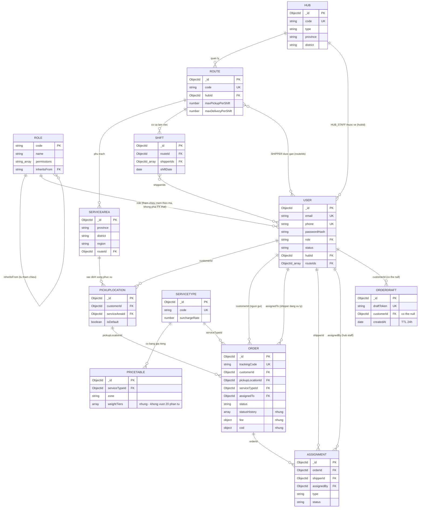

# Sơ đồ thực thể - quan hệ (ERD) — EDMS

Ứng với US-02 / Task T3 (Sprint 1). Mở file này trên GitHub (web) để xem sơ đồ
được vẽ tự động — không cần cài thêm công cụ nào.

## Sơ đồ

## Quy tắc nhúng hay tham chiếu (giải thích thiết kế)

Hai lựa chọn khi một dữ liệu "thuộc về" dữ liệu khác: **nhúng** (embed — lưu
lồng bên trong document cha) hoặc **tham chiếu** (reference — lưu ObjectId trỏ
sang collection khác, giống khóa ngoại nhưng không ép buộc toàn vẹn như SQL).

**Nhúng khi**: dữ liệu luôn được đọc kèm theo "cha" và không vượt quá ~20 phần
tử — tránh phải truy vấn thêm (`$lookup`) mỗi lần đọc danh sách:
- `Order.statusHistory` — lịch sử trạng thái của một đơn, luôn hiển thị kèm chi tiết đơn
- `Order.fee`, `Order.cod`, `Order.receiver`, `Order.item` — thuộc tính riêng của đơn, không có lý do tồn tại độc lập
- `PriceTable.weightTiers` — các bậc khối lượng của một bảng giá

**Tham chiếu khi**: thực thể có vòng đời độc lập, thay đổi không phụ thuộc
thực thể gọi đến nó:
- `Order.customerId`, `Order.assignedTo` → trỏ sang `User` (một user tồn tại độc lập với đơn hàng)
- `Route.hubId`, `ServiceArea.routeId` → trỏ sang `Hub`/`Route`
- `PriceTable.serviceTypeId` → trỏ sang `ServiceType`

**Denormalize có chọn lọc**: một số trường tham chiếu còn được **chép thêm**
bản sao trực tiếp vào document cha để tránh `$lookup` ở các màn hình danh sách
hay gọi — ví dụ `Order.customerName`, `Order.serviceName`, `Order.pickupWard`.
Đánh đổi: nếu tên khách hàng đổi sau này, các đơn cũ vẫn giữ tên cũ tại thời
điểm tạo đơn — đây là chủ ý, không phải lỗi (phí/thông tin đơn phải "đóng băng"
tại thời điểm xác nhận).

## Đối chiếu với code thật

Mỗi hộp trong sơ đồ tương ứng đúng một file trong
`code/apps/api/src/models/` (ví dụ hộp `ORDER` ↔ file `Order.js`). Các mũi tên
tham chiếu (`FK`) tương ứng field khai báo `ref: "TenModel"` trong từng file đó.
