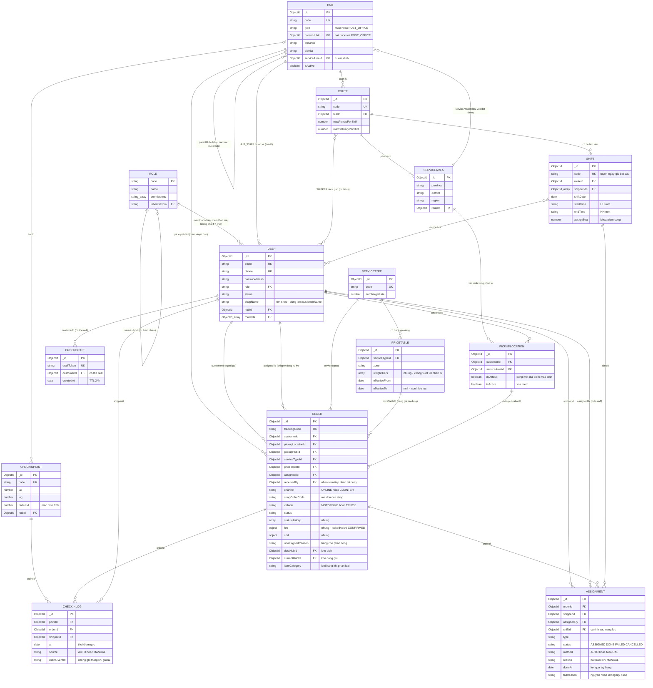

# Sơ đồ thực thể - quan hệ (ERD) — EDMS

Ứng với US-02 / Task T3 (Sprint 1), cập nhật theo Sprint 3 (05/11/2026): cấp bậc hub – bưu cục,
khu vực phục vụ của điểm, hub duyệt đơn, bảng giá đã dùng và thời điểm khóa phí. Mở file này trên
GitHub (web) để xem sơ đồ được vẽ tự động — không cần cài thêm công cụ nào.

## Sơ đồ

## Quy tắc nhúng hay tham chiếu (giải thích thiết kế)

Hai lựa chọn khi một dữ liệu "thuộc về" dữ liệu khác: **nhúng** (embed — lưu
lồng bên trong document cha) hoặc **tham chiếu** (reference — lưu ObjectId trỏ
sang collection khác, giống khóa ngoại nhưng không ép buộc toàn vẹn như SQL).

**Nhúng khi**: dữ liệu luôn được đọc kèm theo "cha" và không vượt quá ~20 phần
tử — tránh phải truy vấn thêm (`$lookup`) mỗi lần đọc danh sách:
- `Order.statusHistory` — lịch sử trạng thái của một đơn, luôn hiển thị kèm chi tiết đơn
- `Order.fee`, `Order.cod`, `Order.receiver`, `Order.item` — thuộc tính riêng của đơn, không có lý do tồn tại độc lập
- `PriceTable.weightTiers` — các bậc khối lượng của một bảng giá
- `Order.fee.lockedAt` — thời điểm đơn chuyển CONFIRMED; từ đó phí cố định, đổi bảng giá về sau
  không làm đổi phí đơn này (US-17)

**Tham chiếu khi**: thực thể có vòng đời độc lập, thay đổi không phụ thuộc
thực thể gọi đến nó:
- `Order.customerId`, `Order.assignedTo` → trỏ sang `User` (một user tồn tại độc lập với đơn hàng)
- `Route.hubId`, `ServiceArea.routeId` → trỏ sang `Hub`/`Route`
- `PriceTable.serviceTypeId` → trỏ sang `ServiceType`
- `Hub.parentHubId` (tự tham chiếu) — bưu cục (`POST_OFFICE`, cấp quận/huyện) trực thuộc một `HUB`
  (điểm tập kết cấp tỉnh/vùng); HUB không có cấp trên. `Hub.serviceAreaId` do `HubService` tự xác
  định từ tỉnh + quận của điểm (US-14)
- `Order.pickupHubId` — điểm quản lý tuyến của khu vực lấy hàng, xác định lúc tạo đơn: nhân viên kho
  điểm này (hoặc hub cấp trên) duyệt đơn (US-18)
- `Order.priceTableId` — bảng giá đã dùng để tính phí; một bảng giá "đã dùng" thì không sửa được nữa

**Denormalize có chọn lọc**: một số trường tham chiếu còn được **chép thêm**
bản sao trực tiếp vào document cha để tránh `$lookup` ở các màn hình danh sách
hay gọi — ví dụ `Order.customerName`, `Order.serviceName`, `Order.pickupWard`.
Đánh đổi: nếu tên khách hàng đổi sau này, các đơn cũ vẫn giữ tên cũ tại thời
điểm tạo đơn — đây là chủ ý, không phải lỗi (phí/thông tin đơn phải "đóng băng"
tại thời điểm xác nhận).

## Collection kỹ thuật (không thuộc 12 collection nghiệp vụ)

`counters` (`models/Counter.js`): `{ _id: "trackingCode", seq }` — bộ đếm tăng dần để sinh mã vận đơn
`EXP` + 10 chữ số. Lệnh `$inc` chạy **trong cùng transaction** với lệnh thêm đơn và xóa bản nháp, nên
hai đơn tạo đồng thời không bao giờ trùng mã, còn transaction bị hủy thì không tốn số. Seed đặt
`seq = 1000000199` (200 đơn mẫu); thiếu bộ đếm thì bắt đầu sau mã lớn nhất đang có. Collection này cố
ý không export qua `models/index.js` nên không có trong sơ đồ và file cấu trúc mongosh.

`settings` (`models/Setting.js`, Sprint 4): `{ _id: "capacity", maxPickupPerShift, maxDeliveryPerShift,
updatedBy }` — năng lực mặc định hệ thống, cấp thấp nhất của năng lực 3 cấp (người giao hàng → tuyến →
hệ thống, US-24). Chỉ quản trị viên đổi; chưa có bản ghi thì dùng 20 lấy / 30 giao mỗi ca. Cũng không
export qua `models/index.js`.

## Đối chiếu với code thật

Mỗi hộp trong sơ đồ tương ứng đúng một file trong
`code/apps/api/src/models/` (ví dụ hộp `ORDER` ↔ file `Order.js`). Các mũi tên
tham chiếu (`FK`) tương ứng field khai báo `ref: "TenModel"` trong từng file đó.
File cấu trúc `code/database/*.mongodb.js` sinh từ các model bằng `npm run db:export`; test
`mongoshExport` báo lỗi nếu file này lệch với model.

Trường `Order.settlementId` đã khai báo sẵn cho đối soát thu hộ; collection đối soát và quan hệ của nó
được thêm vào sơ đồ khi làm story đối soát (Sprint 7, kế hoạch 05/11/2026).
